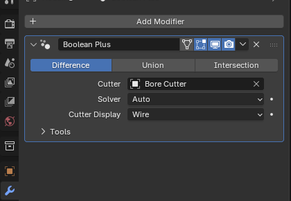

# Mesh Rust Studio

[Русская инструкция](README.ru.md)

Mesh Rust Studio is an independent project based on Blender 5.3 for Windows x64 with Rust implementations for selected operations and extra modeling tools. It uses Blender's `.blend` format, interface and Python API.

## What has improved

Work includes Boolean Plus, Auto UV, QuadriFlow and mesh simplification. First-run setup imports selected settings and links existing asset and extension folders. Work and Dev use separate profiles.

| Benchmark | Before → After | Change |
| --- | ---: | --- |
| First Vulkan frame, warm launch | 1.46 s → 1.15 s (−21%) | Direct launcher removes an extra process |
| Smart UV Project, 81,920 faces | 466 ms → 154 ms (−67%) | Reuses projection comparisons |
| Enter Edit Mode, 1.57M faces | 1,350 ms → 820 ms (−39%) | Faster mesh conversion and pool setup |
| Undo, same mesh | 1,306 ms → 605 ms (−54%) | Faster restoration of edit geometry |

Local Windows benchmark medians. Launch and Smart UV compare earlier project builds. Edit Mode and Undo compare with Blender 5.3.0 under the same test conditions.

## Windows download

Work 0.12 runs on Windows x64. Extract the entire ZIP, then open **Mesh Rust Studio.exe**. It uses its own profile under `%LOCALAPPDATA%\MeshRustStudio\work`. [Download Work for Windows x64](https://github.com/netuneed/mesh-rust-studio/releases/download/v0.12.0-work/MeshRustStudio-Work-0.12-Windows-x64.zip) · [Checksums and source files](https://github.com/netuneed/mesh-rust-studio/releases/tag/v0.12.0-work)

To verify the download, compare the result of this PowerShell command with the matching entry in `SHA256SUMS.txt`.

```powershell
Get-FileHash -Algorithm SHA256 .\MeshRustStudio-Work-0.12-Windows-x64.zip
```

## Boolean Plus

1. Select the mesh you want to modify. Open **Properties > Modifiers > Add Modifier > Blender Plus > Boolean Plus**.
2. Use the **Cutter** eyedropper to pick the other mesh. Choose **Difference**, **Union** or **Intersection**.
3. Use **Solver > Exact** when you want the exact solver. **Auto** can use the manifold solver on suitable operands. **Cutter Display** changes the cutter's viewport display.
4. Expand **Tools** for the preview and apply controls. Older saved Boolean Plus modifiers expose **Enable Editable Controls** to upgrade the selected modifier.



Work 0.12 also fixes a file browser timer crash that could occur while switching viewport orientation with a collapsed Asset Browser. Existing scenes can use the same navigation gizmo and Exact Boolean workflow.

## First launch

1. Extract the entire ZIP to a folder you plan to keep. Give Work and Dev their own folders.
2. Run **Mesh Rust Studio.exe** in the extracted folder. This is a per-user portable installation.
3. Choose **Mesh Rust Studio Setup** on the welcome screen. To reopen it, press **F3** and search for **Mesh Rust Studio Setup**. Choose English or Russian in the setup window.
4. Select a detected Blender 4.2 to 5.3 profile or choose a profile folder. Review the settings to import. Supported settings include UI scale, mouse navigation, Undo and file saving preferences.
5. Attach the local asset libraries you want to use. You can also opt in to reusing local Blender extension repositories. Both features reference existing folders.
6. To open `.blend` and `.blend1` in Work by default, choose **Choose default app** in Work Setup. Then pick **Mesh Rust Studio** for each extension in Windows Settings. [Windows default apps](https://support.microsoft.com/en-us/windows/apps/change-default-apps-in-windows)

Work and Dev keep separate profiles under `%LOCALAPPDATA%\MeshRustStudio`. Enable trusted, compatible extensions individually in Blender. Updates or removals in a shared extension repository affect every Blender installation that uses it. Set up startup scenes, keymaps, themes and legacy add-ons separately.

To update, close Mesh Rust Studio, extract the replacement ZIP to a new folder and run its launcher. Your channel profile is stored separately. If Work was the default app, register it again from the new folder.

## Modeling tools in Work

- **Add Modifier → Mesh Rust Studio → Auto UV** unwraps the mesh produced by earlier modifiers. It writes a separate UV map named `Auto UV` by default. Select that map in the material's UV Map node to use it.
- **N → Mesh Rust Studio → Topology** runs QuadriFlow, Reduce Polygons or Simplify Flat Areas on the evaluated mesh. The tool creates a separate object. **Update Topology** recalculates the selected result from its source. Attribute reprojection, including UVs, is approximate.

Try Dev on a copy of an important project. Check the release notes for any Blender features or add-ons your workflow depends on.

## Source and support

The code is based on [Blender 5.3.0](https://github.com/blender/blender/tree/02f0899d78e374b63e7181d9061e1f7ab03419cc). The release includes the matching source and build instructions. Blender and bundled components retain their licenses. [Blender license](https://docs.blender.org/manual/en/5.3/getting_started/about/license.html)

See [Build Work](BUILDING.md) for the pinned upstream base, native patches and portable packaging.

[Report a bug](https://github.com/netuneed/mesh-rust-studio/issues) · [Report a security issue](SECURITY.md)
