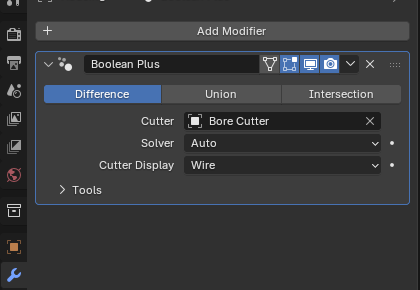

# Mesh Rust Studio

[English README](README.md)

Mesh Rust Studio - независимая сборка Blender 5.3 для Windows x64. Часть операций выполняется на Rust, в сборку добавлены инструменты моделирования. Сохраняются формат `.blend`, интерфейс и Python API Blender.

## Что уже улучшили

В Work есть Boolean Plus, Auto UV, QuadriFlow и упрощение сетки. Мастер первого запуска переносит выбранные настройки и подключает существующие папки ассетов и расширений. У Work и Dev отдельные профили.

| Замер | Было → стало | За счёт чего |
| --- | ---: | --- |
| Первый кадр Vulkan, прогретый запуск | 1,46 с → 1,15 с (−21%) | Прямой запуск без лишнего процесса |
| Smart UV Project, 81 920 граней | 466 мс → 154 мс (−67%) | Повторное использование сравнений при проекции |
| Вход в Edit Mode, 1,57 млн граней | 1 350 мс → 820 мс (−39%) | Ускорение преобразования сетки и подготовки пулов |
| Undo на той же сетке | 1 306 мс → 605 мс (−54%) | Ускорение восстановления геометрии |

Медианы локальных тестов на Windows. Запуск и Smart UV сравнивались с прежними сборками проекта. Edit Mode и Undo сравнивались со штатным Blender 5.3.0 в одинаковых условиях.

## Скачать для Windows

Work 0.12 работает под Windows x64. Распакуйте весь ZIP и запустите **Mesh Rust Studio.exe**. Сборка хранит свой профиль в `%LOCALAPPDATA%\MeshRustStudio\work`. [Скачать Work для Windows x64](https://github.com/netuneed/mesh-rust-studio/releases/download/v0.12.0-work/MeshRustStudio-Work-0.12-Windows-x64.zip) · [Контрольные суммы и исходники](https://github.com/netuneed/mesh-rust-studio/releases/tag/v0.12.0-work)

Чтобы проверить загрузку, сравните результат команды PowerShell со строкой архива в `SHA256SUMS.txt`.

```powershell
Get-FileHash -Algorithm SHA256 .\MeshRustStudio-Work-0.12-Windows-x64.zip
```

## Boolean Plus

1. Выберите меш, к которому хотите добавить вырез. Откройте **Properties > Modifiers > Add Modifier > Blender Plus > Boolean Plus**.
2. Укажите второй меш пипеткой **Cutter**. Выберите вычитание **Difference**, объединение **Union** или пересечение **Intersection**.
3. Для точного расчёта выберите **Solver > Exact**. В режиме **Auto** модификатор может использовать Manifold для подходящих сеток. Вид резака задаёт **Cutter Display**.
4. Настройки предпросмотра и применение находятся в разделе **Tools**. В старом файле выберите **Enable Editable Controls**, чтобы обновить выбранный модификатор.



В Work 0.12 исправлен вылет при обработке таймера файлового браузера. Сбой мог проявиться при переключении вида, если в рабочем пространстве свёрнут браузер ассетов.

## Первый запуск

1. Распакуйте ZIP целиком в папку, где хотите хранить программу. Для Work и Dev используйте разные папки.
2. Запустите **Mesh Rust Studio.exe** из распакованной папки. Это переносимая установка для текущего пользователя.
3. В приветственном окне выберите **Mesh Rust Studio Setup**. Чтобы вернуться к настройке, нажмите **F3** и найдите **Mesh Rust Studio Setup**. В окне можно выбрать русский или английский язык.
4. Выберите найденный профиль Blender от 4.2 до 5.3 или укажите его папку. Проверьте параметры импорта. Можно перенести масштаб интерфейса, навигацию мышью, настройки отмены и сохранения файлов.
5. Подключите нужные локальные библиотеки ассетов. Также можно выбрать уже установленные локальные репозитории расширений Blender. В обоих случаях используются существующие папки.
6. Чтобы `.blend` и `.blend1` по умолчанию открывались в Work, в окне настройки Work нажмите **Выбрать приложение по умолчанию**. В параметрах Windows выберите **Mesh Rust Studio** для каждого расширения. [Приложения по умолчанию в Windows](https://support.microsoft.com/ru-ru/windows/apps/change-default-apps-in-windows)

Work и Dev используют отдельные профили в `%LOCALAPPDATA%\MeshRustStudio`. Включайте доверенные совместимые расширения по одному в Blender. Обновление или удаление расширения из общего репозитория затронет все сборки Blender, которые им пользуются. Стартовые сцены, горячие клавиши, темы и аддоны старого формата настройте отдельно.

Для обновления закройте Mesh Rust Studio, распакуйте новый ZIP в отдельную папку и запустите его лаунчер. Профиль версии хранится отдельно. Если Work был приложением по умолчанию, зарегистрируйте его снова из новой папки.

## Инструменты моделирования в Work

- **Add Modifier > Blender Plus > Auto UV** разворачивает сетку после предыдущих модификаторов. По умолчанию развёртка записывается в отдельную UV-карту `Auto UV`. Чтобы использовать её в материале, выберите эту карту в узле UV Map.
- **N → Mesh Rust Studio → Topology** запускает QuadriFlow, сокращение полигонов или упрощение плоских участков на вычисленной сетке. Инструмент создаёт отдельный объект. **Update Topology** пересчитывает выбранный результат по исходнику. Атрибуты, включая UV, переносятся приближённо.

Проверяйте Dev на копии важного проекта. Если ваша работа зависит от конкретных возможностей Blender или аддонов, сверьтесь с примечаниями к релизу.

## Исходники и поддержка

Проект основан на [Blender 5.3.0](https://github.com/blender/blender/tree/02f0899d78e374b63e7181d9061e1f7ab03419cc). На странице выпуска доступны соответствующие исходники и инструкции сборки. Blender и включённые компоненты сохраняют свои лицензии. [Лицензия Blender](https://docs.blender.org/manual/en/5.3/getting_started/about/license.html)

Рабочий процесс и инструкции сборки сохранены в разделе [Сборка исходников](BUILDING.md).

[Сообщить об ошибке](https://github.com/netuneed/mesh-rust-studio/issues) · [Сообщить об уязвимости](SECURITY.md)
